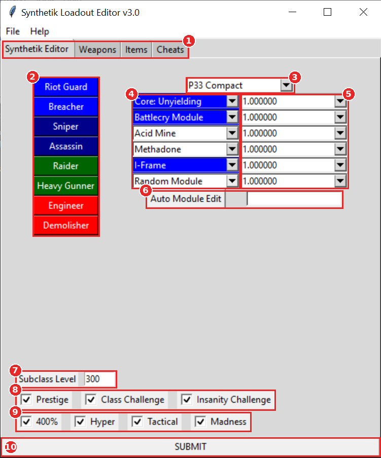
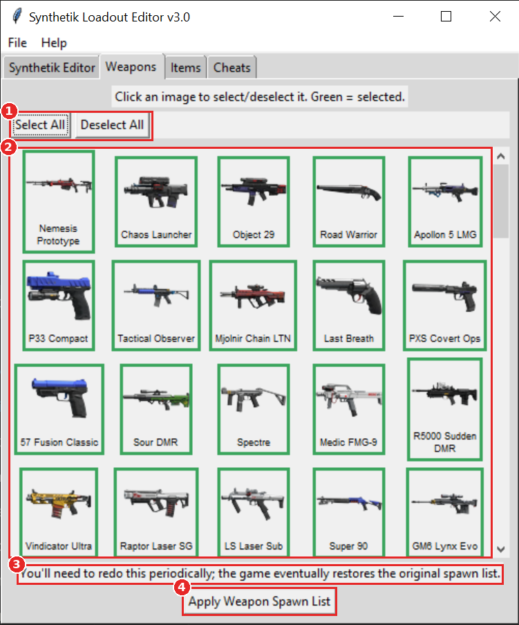
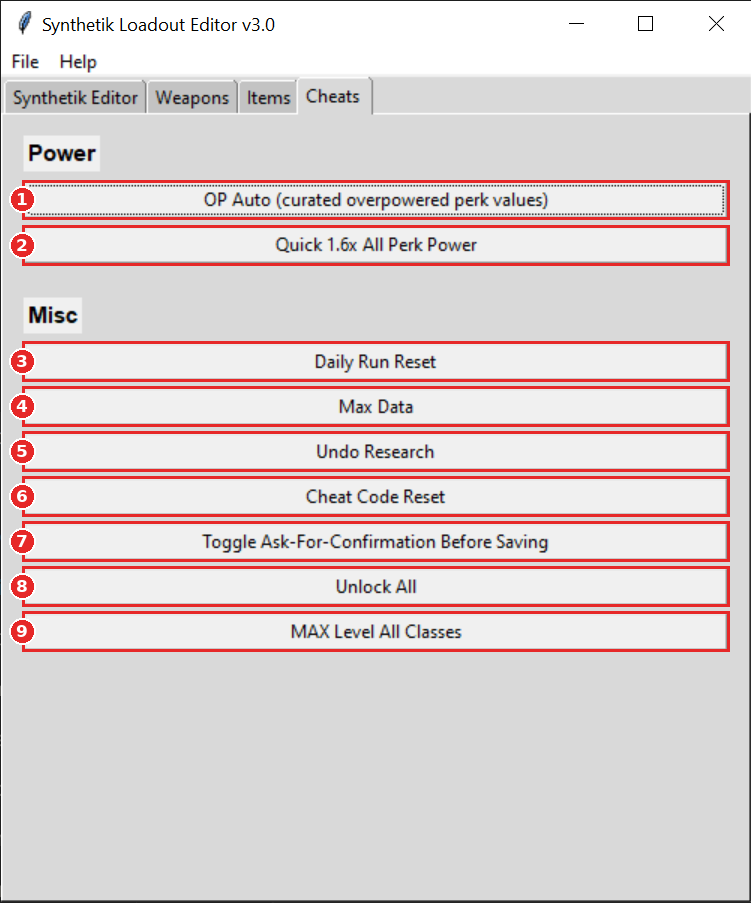

# Synthetik_Python_Mod
A save editor tool for the game Synthetik written in python.
if it can't find your save file, try looking in username/appdata/local/synthetik it should be called Save.sav
(you may have to type that directly into the file-path)

You definitely need to have Synthetik closed when you change anything.

# Features

The editor just edits text values in your `Save.sav`. Nothing is injected into the game. Windows only.

## Synthetik Editor tab

1. **Tabs** - switch between the loadout editor, the weapon and item spawn lists, and the cheats.
2. **Class buttons** - pick which class/subclass to edit (Riot Guard, Breacher, Sniper, Assassin, Raider, Heavy Gunner, Engineer, Demolisher). Your current loadout for that class loads automatically. Colors match the class family: Guardian blue, Rogue dark blue, Commando green, Specialist red.
3. **Pistol** - change the class's pistol.
4. **Module slots** - change all 6 modules. Dropdown colors show where each module comes from (class, Mode, Artefact, or Other).
5. **Module power** - set the power value of each module you picked. changing Weapon power does nothing.
6. **Auto Module Edit** - type a number and press the button to set the power of *every* perk to that number.
7. **Subclass Level** - set the level of the selected class.
8. **Prestige / Class Challenge / Insanity Challenge** - mark these as completed for the selected class. Checking Insanity Challenge ticks all four insanity boxes and Class Challenge too.
9. **Insanity sub-challenges** - 400%, Hyper, Tactical, and Madness can each be set individually.
10. **SUBMIT** - writes everything on this tab to your save file.

## Weapons tab (and Items tab)

The Items tab works exactly the same way, just with items.

1. **Select All / Deselect All** - quickly check or uncheck everything.
2. **Spawn grid** - click a picture to toggle it. Green border = can spawn, no border = can't. It reads your save file when it opens, so it shows what can and can't spawn on your next run.
3. **Heads up** - the game eventually restores its original spawn list, so you'll need to redo this periodically. In normal play, this function makes it so you don't recive the same weapons items over and over.
4. **Apply Weapon Spawn List** - writes your selection to the save. Checked weapons get a much higher drop chance (weapons are also unlocked), and unchecked ones are suppressed.

## Cheats tab

1. **OP Auto** - sets all perks to a curated list of overpowered values. Your mileage may vary. Just one of these should make you basically unstoppable.
2. **Quick 1.6x All Perk Power** - sets all perk power to 1.6, the normal maximum perk power.
3. **Daily Run Reset** - lets you do the daily run again.
4. **Max Data** - sets your Data to 1000.
5. **Undo Research** - relocks all your laboratory research. can be helpful for turning off groups of weapon variants again.
6. **Cheat Code Reset** - resets your cheat codes.
7. **Toggle Ask-For-Confirmation Before Saving** - by default every change saves immediately. Turn this on to get a "Do you want to overwrite your Save File?" prompt first.
8. **Unlock All** - unlocks all perks and items, and pays for all the laboratory research.
9. **MAX Level All Classes** - sets every subclass to level 25 with Prestige, Class Challenge, and all Insanity challenges completed.

## Menus
- **File > Show** opens your save file in your default editor.
- **Help > Not working?** has troubleshooting tips, including why crates can come up empty when only rare items are allowed to spawn (early floors limit item rarity; cursed and boss chests don't).

# Version 3.1
### Now works with Beta-27! still works with the old save files too.
### Finally updated the spawn menus! they now have pictures so you can tell at a glance what you're selecting or not!
### removed old stuff and moved things around so it looks better.
### Refactored the code so now it's class-based!
### Made the spawn menu read your save file so now you can clearly see what can and can't spawn on your next run

## -Now, i gotta tell you, this is some thrown together, dumb as frick code written in python. there's probably bugs.
## -However, the largest bug probable is the deletion of your current day's save file. There are two backups in the same folder already in the game, you can just copy and paste.
## I used (https://towardsdatascience.com/how-to-easily-convert-a-python-script-to-an-executable-file-exe-4966e253c7e9) to generate the exe file from my code. thank you to Caesar_Salad on discord for showing me that it worked without downloading python!
## Thank you to Tactu on discord for general coding advice, and helping edit the UI!

# Future Updates:

### Adding images to the class menu so that everything looks nicer. Possibly make it look like the actual game? probably not.
### Adding a presets menu for suggested builds! suggest yours at https://docs.google.com/forms/d/e/1FAIpQLSchH_09LSdEpPIWGewat-cNCmyhP9SNTbX6xTL8_TRrcoMmiA/viewform!
